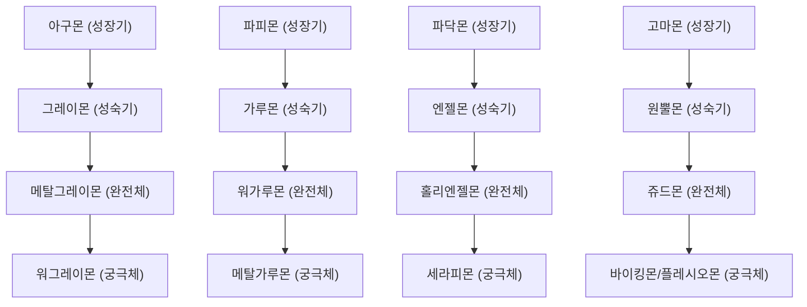

# 02. 캐릭터 및 진화 승계 시스템 (Characters & Evolution)

## 1. 스타터 디지몬 8종 (Starter Digimon)

플레이어는 게임 시작 시 원작의 개성을 담은 8마리의 성장기 디지몬 중 하나를 선택할 수 있습니다.

| 디지몬 | 속성 | 고유 시그니처 스킬 | 공격 메커니즘 | 특성 및 성장 방향 |
| :--- | :---: | :--- | :--- | :--- |
| **아구몬 (Agumon)** | Vaccine | 베이비 플레임 (Baby Flame) | 전방 관통형 화염구 발사 | 공격력과 폭발 반경 중심 |
| **파피몬 (Gabumon)** | Data | 쁘띠 파이어 (Petit Fire) | 플레이어 주위를 회전하는 영혼 도깨비불 | 방어 및 근접 배리어 중심 |
| **피요몬 (Piyomon)** | Vaccine | 매지컬 파이어 (Magical Fire) | 초고속 유도 화염깃털 발사 | 빠른 연사 및 이동속도 중심 |
| **텐토몬 (Tentomon)** | Vaccine | 꼬마 벼락 (Petit Thunder) | 적군 사이를 연쇄 연타하는 벼락 | 다단 히트 및 감전 CC 중심 |
| **팔몬 (Palmon)** | Data | 독줄기 채찍 (Poison Ivy) | 전방 원뿔형 덩굴 채찍 휘두르기 | 광역 지속 중독 피해 |
| **고마몬 (Gomamon)** | Vaccine | 물고기 행진 (Surfing Fish) | 굽이치며 적을 휩쓰는 해일 파도 | 넉백 및 광역 제어 중심 |
| **파닥몬 (Patamon)** | Vaccine | 공기팡 (Air Shot) | 초음속 고압 충격파 탄환 | 원거리 관통 및 강력한 넉백 |
| **피코데블몬 (PicoDevimon)** | Virus | 피코 다트 (Pico Dart) | 3방향 회전 암흑 크리스탈 단검 | 흡혈 및 치명타 중심 |

---

## 2. 단계별 진화 트리 (Evolution Trees)

일정 레벨에 도달하면 진화 선택 팝업이 활성화되어 상위 단계로 디지몬을 진화시킬 수 있습니다.



---

## 3. 고유 스킬 레벨 및 능력치 승계 메커니즘
* **문제점 해결**: 기존에는 진화 시 고유 스킬이 상위 스킬(예: 베이비 플레임 -> 메가 플레임)로 교체되면서 스킬 레벨이 1로 초기화되어 공격력이 급감하는 문제가 있었습니다.
* **승계 로직 ([`MainWindow.xaml.cs`](file:///D:/Project/DigimonSurvivors/MainWindow.xaml.cs))**:
  1. 진화 전 보유하고 있던 시그니처 무기의 현재 레벨(`weapon.Level`)을 임시 보존.
  2. 진화 후 새로 습득하는 상위 시그니처 스킬에 해당 레벨 수치를 즉시 복사 및 재동기화:
     ```csharp
     var oldSig = Player.Weapons.FirstOrDefault(w => w.Skill.Id == oldProfile.SignatureWeaponId);
     int inheritedLevel = oldSig != null ? oldSig.Level : 1;
     // 새 진화 스킬 레벨을 이전 레벨로 즉시 보존 승계
     newWeapon.Level = inheritedLevel;
     newWeapon.ApplyLevelStats();
     ```
  3. 진화 시 증가하는 기본 스탯(최대 HP, 공격력 DP, 이동속도 SPD)과 함께 스킬의 레벨업 강화 수치가 그대로 온전히 누적 반영됩니다.

---

## 4. 캐릭터 비주얼 혁신 (원형 프레임 탈피 -> 스탠디 아트)

사용자의 피드백("캐릭터 디자인이 원형안에 그림만 있는거 마음에 안들어")을 반영하여 캐릭터 표현 방식을 근본적으로 개편했습니다.

1. **UI 선택창 및 진화 모달 테두리 개편 ([`MainWindow.xaml`](file:///D:/Project/DigimonSurvivors/MainWindow.xaml))**:
   * 기존: 70x70 픽셀의 `CornerRadius="35"` 동그란 포커칩 형태.
   * 변경: 세련된 82x82 픽셀의 네온 사이버 받침대(Pedestal)형 라운드 사각 프레임 (`CornerRadius="12"`, 테두리 `#00E5FF`).
2. **24종 전 캐릭터 스탠디 생성기 구현 ([`DigimonTokenGenerator.cs`](file:///D:/Project/DigimonSurvivors/Tools/DigimonTokenGenerator.cs))**:
   * 강제 원형 타원 클리핑(`EllipseGeometry`)을 완전히 삭제.
   * 캐릭터의 원본 실루엣을 살리는 소프트 알파 페이드 마스크 적용.
   * 속성별(백신-시안, 데이터-에메랄드, 바이러스-자주) 은은한 오라 후광 추가.
   * 바닥 접지 그림자(Contact Shadow)를 추가하여 공중에 떠 있는 느낌을 배제하고 당당한 스탠디 아트로 재구축.
3. **인게임 렌더링 정리 ([`GameCanvas.cs`](file:///D:/Project/DigimonSurvivors/Rendering/GameCanvas.cs))**:
   * 플레이어를 둘러싸던 360도 쿨다운 원형 링을 제거하고, 전방 전투 방향 쉐브론 가이드 및 자연스러운 발밑 접지 그림자 적용.
   * 적 피격 및 빙결 시 인위적인 원형 오버레이 대신 다이아몬드 크리스탈 및 섬광 하이라이트 적용.
